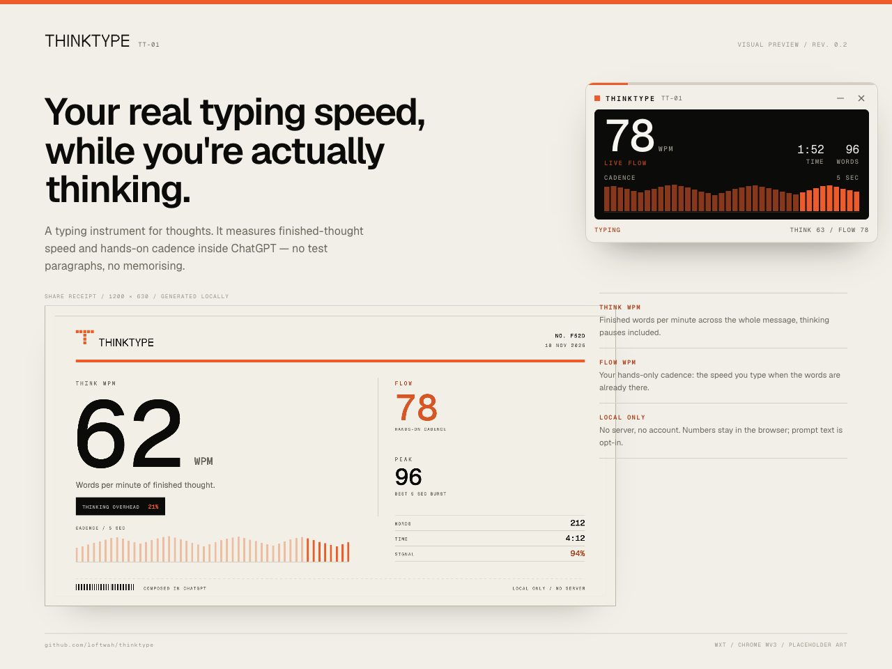
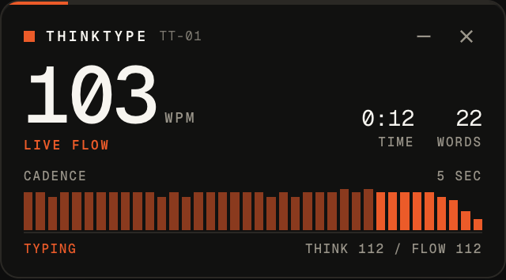
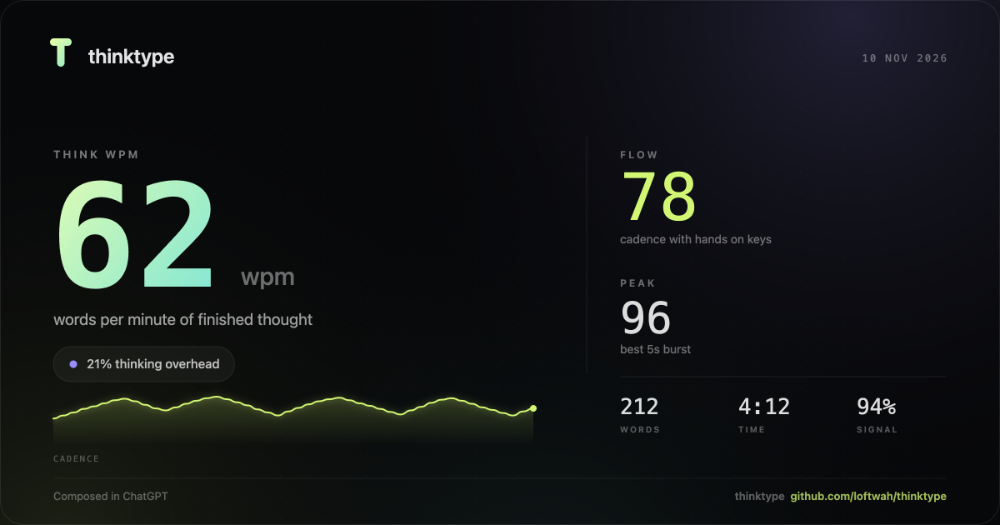
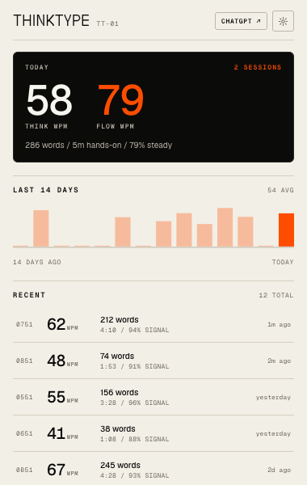
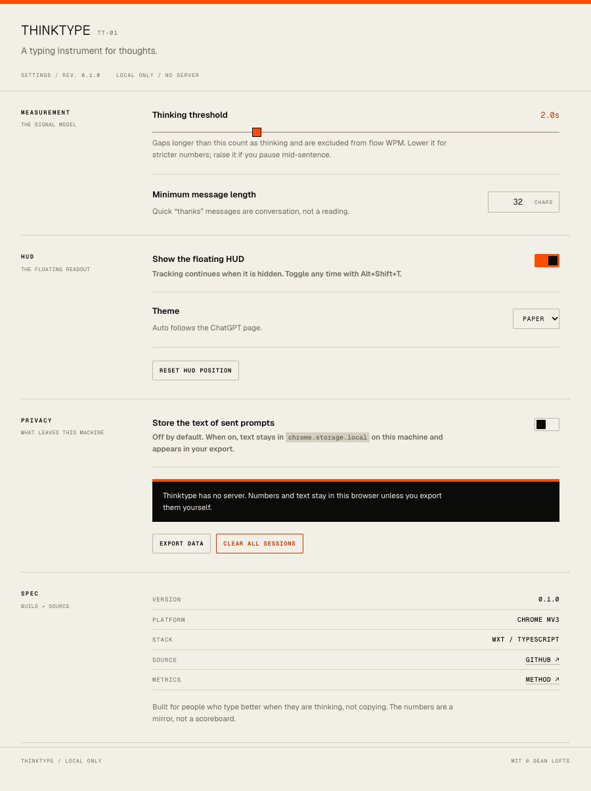

<div align="center">
  
</div>

<h1 align="center">thinktype</h1>

<p align="center"><strong>A typing instrument for thoughts.</strong></p>

<p align="center">
  Chrome MV3 · <a href="docs/METRICS.md">how the metrics work</a> ·
  <a href="DESIGN.md">design notes</a> · <a href="CONTRIBUTING.md">contributing</a>
</p>

Thinktype measures how fast you compose your own words inside ChatGPT, separates thinking time from
hands-on typing time, and prints a receipt for every prompt you send.

Typing tests measure transcription: the sentence already exists. That number says very little about
writing original thought. Thinktype has no target text, so it measures the thing you actually care
about — how quickly a finished idea becomes text — and shows both clocks:

- **Think WPM** — the whole message, thinking pauses included.
- **Flow WPM** — your hands-only cadence when the words are already there.

The gap between them is the interesting part.

## The instrument

The visual world is a field instrument, not a SaaS dashboard. The reference is **Teenage
Engineering**'s anodised black, signal orange, technical-label language (OP-1 field, TX-6) — the
palette, type, density and one signature move, not a pretend hardware shell.

The type system is Vercel's **Geist** family, self-hosted under the SIL Open Font License:

| Face | Job |
| --- | --- |
| **Geist Sans** | UI, running copy, settings prose |
| **Geist Mono** | Every number, technical label, serial and timestamp |
| **Geist Pixel Square** | The T mark and display wordmark only — never body copy |

No gradient text, glass, glows, or serif accents. The signature move is the **receipt**: when you
send a prompt, the HUD prints a paper receipt. That receipt is also the share card.

Geist is bundled in `public/fonts/`. Inside ChatGPT the font files are inlined as `data:` URIs in the
content script, because the page's CSP allows `font-src data:` but not `chrome-extension:`.

## What it measures

| Metric | Definition |
| --- | --- |
| **Think WPM** | Final characters ÷ 5 ÷ wall-clock minutes, from first keystroke to send. |
| **Flow WPM** | Inserted characters ÷ 5 ÷ active minutes. Gaps over the idle threshold are clamped out. |
| **Peak** | Best 5-second burst. |
| **Consistency** | 100 minus the coefficient of variation of inter-key intervals. |
| **Correction rate** | Deleted characters as a share of all edit keystrokes. |
| **Thinking overhead** | `1 − think/flow`; the share of raw cadence consumed by thinking. |
| **Signal** | How much of the final text is attributable to observed keystrokes. |
| **Pauses** | Gaps over the idle threshold, with a median and longest. |

There is no target text, so "accuracy" is not meaningful here. Correction rate plus signal quality
is the honest replacement. The formulas and limitations are in [docs/METRICS.md](docs/METRICS.md).

## Install

```bash
git clone https://github.com/loftwah/thinktype.git
cd thinktype
npm install
npm run dev
```

`npm run dev` starts WXT and opens Chrome with the extension loaded. If you prefer a production
build:

```bash
npm run build
# chrome://extensions -> Developer mode -> Load unpacked -> .output/chrome-mv3
```

Prefer a packaged download? Grab the
[latest release](https://github.com/loftwah/thinktype/releases/latest), unzip it, and load the folder.

Open [chatgpt.com](https://chatgpt.com), start a new chat, and type a real prompt. The HUD appears in
the top-right. Send the message to get a receipt; **Copy receipt** puts the card on your clipboard.

Toggle the HUD any time with <kbd>Alt</kbd> + <kbd>Shift</kbd> + <kbd>T</kbd>.

## Screenshots

<p align="center">
  
</p>

<p align="center">
  
</p>

<p align="center">
  
  
</p>

More placeholder captures live in [docs/art](docs/art), including the session detail view.

## How it works

- **WXT** owns the manifest, entrypoints, dev server and store packaging. Chrome MV3 first; the
  structure is ready for Firefox.
- A content script finds ChatGPT's composer (`div.ProseMirror[data-composer-markdown]`, with
  fallbacks for older textareas and generic editables).
- It listens to `keydown`, `beforeinput`, `paste` and input events. It never intercepts or rewrites a
  keystroke.
- On send — Enter or the send button, followed by the composer clearing — it computes stats from the
  final text plus keystroke timings.
- Only metrics are written to `chrome.storage.local`. There is no network code in the extension.
- The HUD lives in a shadow root; the share card is drawn with Canvas at 2× and copied as a PNG.

## Privacy

- No server, no account, no analytics.
- Prompt text is **not stored** by default.
- Stored: WPM numbers, word counts, timings, confidence, timestamp, hostname.
- Optional: enable **Store the text of sent prompts** in settings. It stays in local storage and is
  included in your export.
- Export or clear everything from the options page.

## Project layout

```text
entrypoints/
  background.ts          service worker: badge + keyboard command
  content.ts             content-script bootstrap
  popup/                 history, chart, receipt detail
  options/               measurement, HUD, privacy settings
content/
  composer.ts            resilient composer discovery and text extraction
  tracker.ts             DOM adapter: keystrokes -> sessions
  typing-session.ts      pure measurement state machine (tested)
  overlay.ts/.css        floating HUD in a shadow root
  font-faces.ts          data-URI fonts for the page context
shared/
  metrics.ts             pure WPM / consistency / pause math (tested)
  share-card.ts          1200x630 canvas receipt
  storage.ts             chrome.storage.local helpers
  brand.ts               palette, type, font faces, serials
public/
  fonts/                 Geist Sans / Mono / Pixel + OFL
  icon/                  16/32/48/128 pixel-T icons
demo/                    Vite visual preview without installing the extension
tests/                   24 unit tests for the state machine and metrics
wxt.config.ts            manifest and permissions
```

## Development

```bash
npm run dev        # WXT dev server + Chrome
npm run typecheck  # tsc --noEmit
npm test           # vitest
npm run build      # .output/chrome-mv3
npm run zip        # .output/thinktype-0.1.0-chrome.zip
npm run demo       # visual preview at localhost:4173
npm run icons      # regenerate public/icon from assets/icon.svg
```

`npm run typecheck && npm test && npm run build` is the full check.

## Limitations (v0.1)

- ChatGPT ships UI changes often. Selectors have layered fallbacks, but a redesign can still break
  attachment until the selector list is updated.
- IME input (Chinese, Japanese, etc.) is flagged and lowers the signal score; keystroke counts are
  approximate there.
- Typing into an existing draft is not counted. Start from an empty composer.
- Autocorrect, undo and paste lower confidence rather than pretending to be precise.
- Chrome only for now. The measurement core is host-agnostic; WXT makes Firefox a realistic next
  target.

## Roadmap

Short version: calibrate thresholds against real sessions, add a personal baseline, weekly recaps,
better IME handling, and then other chat UIs. Full list in [docs/ROADMAP.md](docs/ROADMAP.md).

## License

MIT © Dean Lofts. Geist is © Vercel and licensed under the SIL Open Font License 1.1; the license
text ships in `public/fonts/OFL.txt`.
