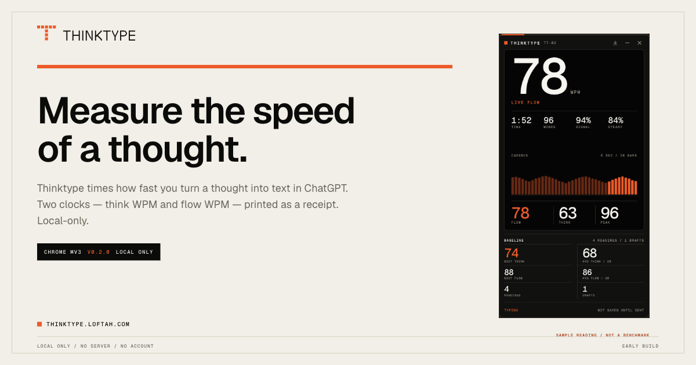
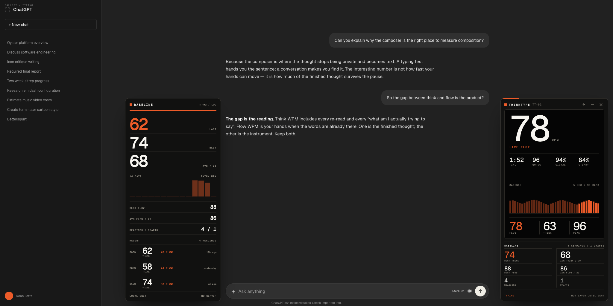
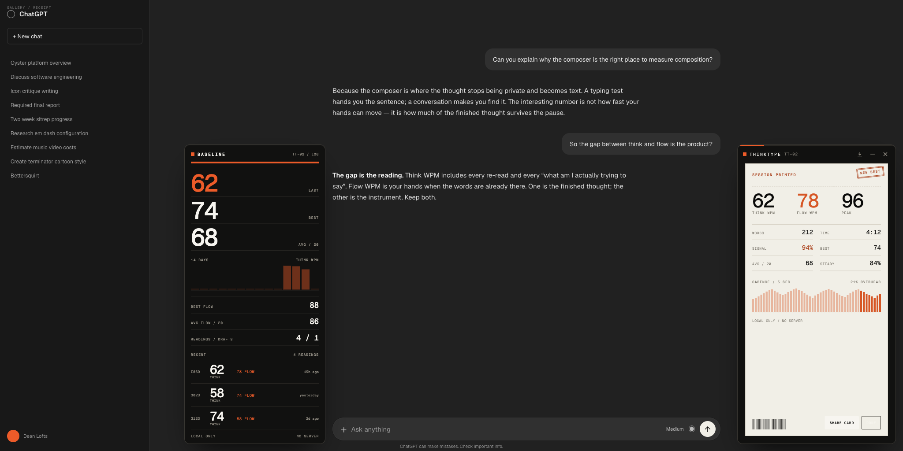
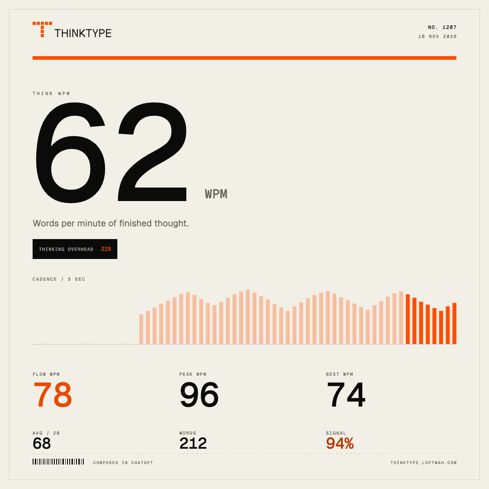

<div align="center">
  
</div>

<h1 align="center">thinktype</h1>

<p align="center"><strong>A typing instrument for thoughts.</strong></p>

<p align="center">
  <a href="https://thinktype.loftwah.com">Live site</a> ·
  Chrome MV3 ·
  <a href="docs/METRICS.md">how the metrics work</a> ·
  <a href="DESIGN.md">design notes</a> ·
  <a href="CONTRIBUTING.md">contributing</a>
</p>

Thinktype measures how fast you compose your own words inside ChatGPT, separates thinking time from
hands-on typing time, and prints a receipt for every prompt you send.

Typing tests measure transcription: the sentence already exists. That number says very little about
writing original thought. Thinktype has no target text, so it measures the thing you actually care
about — how quickly a finished idea becomes text — and shows both clocks:

- **Think WPM** — the whole message, thinking pauses included.
- **Flow WPM** — your hands-only cadence when the words are already there.

The gap between them is the interesting part. A pause is not a reset: the HUD holds the live reading
in THINKING and the idle state shows your last, best and rolling average.

**Live:** https://thinktype.loftwah.com · **Current build:** v0.2.0 (early, unpacked install)

## The instrument

The visual world is a field instrument, not a SaaS dashboard. The reference is **Teenage
Engineering**'s anodised black, signal orange, technical-label language (OP-1 field, TX-6) — the
palette, type, density and one signature move, not a pretend hardware shell.

The HUD is a tall anodised black instrument with a black LCD, anchored to the bottom of the viewport
and docked in the empty gutter beside the conversation. It has a fixed 680px frame and three widths
— 360px full, 286px medium and 142px slim — and collapses to a 60px orb when no gutter fits. It never
covers the composer, send button or the last message. The primary reading is 72–120px; the cadence
meter is 38 bars. When the left gutter allows it, a companion baseline rail shows LAST / BEST / AVG,
a 14-day chart and the recent readings. The live HUD is dark; the receipt and documents are paper.

The type system is Vercel's **Geist** family, self-hosted under the SIL Open Font License:

| Face | Job |
| --- | --- |
| **Geist Sans** | UI, running copy, settings prose |
| **Geist Mono** | Every number, technical label, serial and timestamp |
| **Geist Pixel Square** | The T mark and display wordmark only — never body copy |

No gradient text, glass, glows, or serif accents. The signature move is the **receipt**: when you
send a prompt, the HUD prints a paper receipt. That receipt is also the share card, in three designed
formats.

## What it measures

| Metric | Definition |
| --- | --- |
| **Think WPM** | Final characters ÷ 5 ÷ wall-clock minutes, from first keystroke to send. |
| **Flow WPM** | Inserted characters ÷ 5 ÷ active minutes. Gaps over the idle threshold are clamped. |
| **Peak** | Best 5-second burst. |
| **Consistency** | 100 minus the coefficient of variation of inter-key intervals. |
| **Correction rate** | Deleted characters as a share of all edit keystrokes. |
| **Thinking overhead** | `1 − think/flow`; the share of raw cadence consumed by thinking. |
| **Signal** | How much of the final text is attributable to observed keystrokes. |
| **Pauses** | Gaps over the idle threshold, with a median and longest. |
| **Best / average** | Durable best think, flow and peak; last eligible run; weighted 20-session rolling average; all-time average. |

There is no target text, so "accuracy" is not meaningful here. Correction rate plus signal quality
is the honest replacement. The formulas, eligibility gates and limitations are in
[docs/METRICS.md](docs/METRICS.md).

## Install

```bash
git clone https://github.com/loftwah/thinktype.git
cd thinktype
npm install
npm run dev
```

`npm run dev` starts WXT and opens Chrome with the extension loaded. If you prefer a production
build:

```bash
npm run build
npm run unpacked
```

Then open `chrome://extensions`, enable Developer mode, choose **Load unpacked**, and select the
visible `unpacked/` folder.

The raw build lives in `.output/`, which macOS hides because it starts with a dot. If you want to
load it directly, press <kbd>⌘</kbd> + <kbd>Shift</kbd> + <kbd>G</kbd> in the file picker and paste
`/Users/YOU/gits/thinktype/.output/chrome-mv3`; <kbd>⌘</kbd> + <kbd>Shift</kbd> + <kbd>.</kbd>
toggles hidden folders in Finder.

Prefer a packaged download? Grab the
[latest release](https://github.com/loftwah/thinktype/releases/latest), unzip it, and load the folder.

Open [chatgpt.com](https://chatgpt.com), start a new chat, and type a real prompt. The HUD docks in
the bottom gutter. Send the message to get a receipt; **Share card** opens the format sheet. Toggle
the HUD any time with <kbd>Alt</kbd> + <kbd>Shift</kbd> + <kbd>T</kbd>.

## Screenshots

<p align="center">
  
</p>

<p align="center">
  
</p>

<p align="center">
  
</p>

Sample data only. These are sample readings, not user data or a benchmark. More captures are in
[docs/art](docs/art); the three card formats are in [docs/art/share](docs/art/share).

## How it works

- **WXT** owns the manifest, entrypoints, dev server and store packaging. Chrome MV3 first; the
  structure is ready for Firefox.
- A content script finds ChatGPT's composer (`div.ProseMirror[data-composer-markdown]`, with
  fallbacks for older textareas and generic editables).
- It listens to `keydown`, `beforeinput`, `paste` and input events. It never intercepts or rewrites a
  keystroke.
- On send — Enter or the send button, followed by the composer clearing — it computes stats from the
  final text plus keystroke timings and writes a text-free record.
- `shared/metrics.ts` owns the measurement and eligibility rules. A session needs a sent prompt, 3s
  wall time, the minimum characters, 50% signal and less than 50% paste. Resumed drafts go to a
  draft bucket; IME bests need 85% signal.
- Durable history in `chrome.storage.local`: best think/flow/peak, last eligible run, a weighted
  20-session rolling average, all-time average and totals. A lower run never overwrites a best.
- An in-progress snapshot in `chrome.storage.session` contains no text and is shown as
  `PAUSED / NOT RECORDED` after a reload.
- The HUD lives in a shadow root; the share cards are drawn on Canvas at 1200×630, 1080×1080 and
  1080×1920. There is no network code in the extension.

## Marketing site

The static site lives in `site/` and is built into `site/dist` by
`scripts/build-site.mjs`. It is plain HTML/CSS, no client JavaScript.

```bash
npm run site:build
PORT=4319 npm run site:serve   # http://127.0.0.1:4319
npm run site:deploy            # needs CLOUDFLARE_* in .env
```

The site is deployed on **Cloudflare Pages** as the `thinktype` project and served at
**https://thinktype.loftwah.com**. The DNS record is a CNAME from `thinktype.loftwah.com` to
`thinktype-7sb.pages.dev`. No R2 bucket is used; the Pages assets are enough.

SEO/OG assets:

- `https://thinktype.loftwah.com/social/og-1200x630.png`
- `https://thinktype.loftwah.com/social/x-1200x675.png`
- `https://thinktype.loftwah.com/social/instagram-1080x1080.png`
- `https://thinktype.loftwah.com/social/story-1080x1920.png`
- `https://thinktype.loftwah.com/social/github-1280x640.png`

The site includes canonical URLs, Open Graph and Twitter tags, JSON-LD `SoftwareApplication`, a
sitemap, robots.txt, a 404 page, a favicon, a web manifest and long-lived cache headers for fonts and
images.

## Privacy

- No server, no account, no analytics.
- Prompt text is **not stored** by default.
- Stored: WPM numbers, word counts, timings, confidence, timestamp, hostname.
- In-progress: a text-free snapshot in `chrome.storage.session`.
- Optional: enable **Store the text of sent prompts** in settings. It stays in local storage and is
  included in your export.
- Export or clear everything from the options page.
- Permissions: `storage`, `clipboardWrite`, and the two ChatGPT host permissions. No new permissions
  in v0.2.0.

Canonical policy: https://thinktype.loftwah.com/privacy · Source: [docs/PRIVACY.md](docs/PRIVACY.md)

## Project layout

```text
entrypoints/
  background.ts          service worker: badge + keyboard command
  content.ts             content-script bootstrap, history sync, live snapshots
  popup/                 history, baseline, chart, receipt detail, share sheet
  options/               measurement, HUD, privacy settings
content/
  composer.ts            resilient composer discovery and text extraction
  tracker.ts             DOM adapter: keystrokes -> sessions
  typing-session.ts      pure measurement state machine (tested)
  overlay.ts/.css        vertical HUD, receipt and share sheet in a shadow root
  font-faces.ts          data-URI fonts for the page context
shared/
  metrics.ts             pure WPM / history / eligibility math (tested)
  share-card.ts          three canvas receipt formats
  storage.ts             chrome.storage.local/session helpers
  brand.ts               palette, type, font faces, serials
site/                    static marketing site (HTML/CSS)
docs/
  METRICS.md             formulas and eligibility rules
  NAMES.md               name and domain screening
  art/                   social, store and share art
public/
  fonts/                 Geist Sans / Mono / Pixel + OFL
  icon/                  16/32/48/128 pixel-T icons
demo/                    Vite visual preview, gallery, artboards, card exporter
tests/                   38 unit tests for the state machine and metrics
wxt.config.ts            manifest and permissions
```

## Development

| Command | What it does |
| --- | --- |
| `npm run dev` | Start WXT and Chrome |
| `npm run typecheck` | `tsc --noEmit` |
| `npm test` | Run the Vitest suite |
| `npm run build` | Production build in `.output/chrome-mv3` |
| `npm run unpacked` | Copy the build to the visible `unpacked/` folder |
| `npm run zip` | Store-ready zip in `.output/` |
| `npm run demo` | Visual preview at `localhost:4173` |
| `npm run site:build` | Build `site/dist` with fonts, art and icons |
| `npm run site:serve` | Serve `site/dist` (override with `PORT=4319`) |
| `npm run site:deploy` | Build and deploy to Cloudflare Pages |
| `npm run icons` | Regenerate `public/icon` from `assets/icon.svg` |
| `npm run check` | Typecheck, test and build |

`npm run typecheck && npm test && npm run build` is the full check.

> **zsh note:** interactive comments are off by default, so a trailing `# comment` is passed to the
> command as arguments. Run commands on their own, or add `setopt interactivecomments` to `~/.zshrc`.

## Limitations (v0.2)

- ChatGPT ships UI changes often. Selectors have layered fallbacks, but a redesign can still break
  attachment until the selector list is updated.
- IME input (Chinese, Japanese, etc.) is flagged; it counts toward averages above 50% signal and is
  excluded from best below 85%.
- An existing draft is measured from the next keystroke. The draft text itself is not retroactively
  counted; the HUD shows `DRAFT` until you start typing. Resumed drafts are excluded from best and
  averages.
- Autocorrect, undo and paste lower confidence rather than pretending to be precise.
- The HUD can only be as large as the side gutter allows. At 1440 with the sidebar open it is a slim
  142px strip; at 1280 with the sidebar open it may use the sidebar area. Hide the sidebar for the
  full 300px instrument.
- Chrome only for now. The measurement core is host-agnostic; WXT makes Firefox a realistic next
  target.
- The Chrome Web Store listing has not been submitted. Store screenshots 2–5 still need real
  captures.

## Roadmap

Short version: calibrate thresholds against real sessions, add a personal baseline band, weekly
recaps, better IME handling, and then other chat UIs. Full list in [docs/ROADMAP.md](docs/ROADMAP.md).

## License

MIT © Dean Lofts. Geist is © Vercel and licensed under the SIL Open Font License 1.1; the license
text ships in `public/fonts/OFL.txt`.
